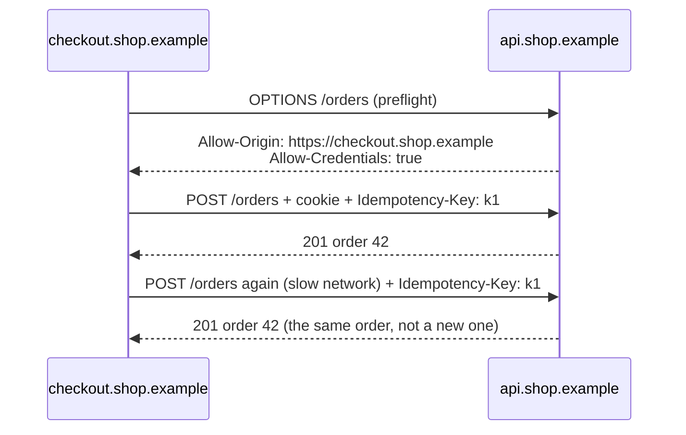

# Weekend 1 boss: model answer

Read this only after the chat with the coach. Compare it with your own doc.
Your answer can be different and still good. What matters is that you named the trade-offs.

## Problem

The new checkout page and the API are on different origins. The browser blocks the calls, sends no login cookie, and a slow network creates double orders.
We know it is fixed when a test customer can pay once, with one tap, and see one order.

## Options and decision

| Problem | Options | Decision |
|---|---|---|
| 1. Browser blocks the calls | A: Serve the API under the checkout origin with a proxy. B: Add CORS headers on the API for `https://checkout.shop.example`. | B. The API opts in for one named origin. Source: [MDN: CORS](https://developer.mozilla.org/en-US/docs/Web/HTTP/Guides/CORS) |
| 2. No login cookie | A: Send the token in a header instead of a cookie. B: Keep the cookie, set `credentials: "include"`, and answer `Access-Control-Allow-Credentials: true`. | B. It is the smallest change. The origin stays one name, never `*`. Source: [MDN: CORS, credentials](https://developer.mozilla.org/en-US/docs/Web/HTTP/Guides/CORS#requests_with_credentials) |
| 3. Double orders | A: Disable the Pay button after one tap. B: Send an idempotency key with each payment. | Both. The button helps most people. Only the key makes a retry safe. Sources: [RFC 9110, 9.2.2](https://www.rfc-editor.org/rfc/rfc9110.html#name-idempotent-methods), [Stripe](https://docs.stripe.com/api/idempotent_requests) |

## Trade-offs

- A CORS rule for one origin is safe, but every new site needs a change on the API.
- Cookies across origins need care. A wrong origin rule could let another site use the cookie.
- An idempotency key means the API must store keys and their results.

## Risks

- A typo in the allowed origin breaks checkout again. A test on the real address catches it.
- A key that is reused for a different payment returns the old result. The client must make a new key per payment.

## Diagram

