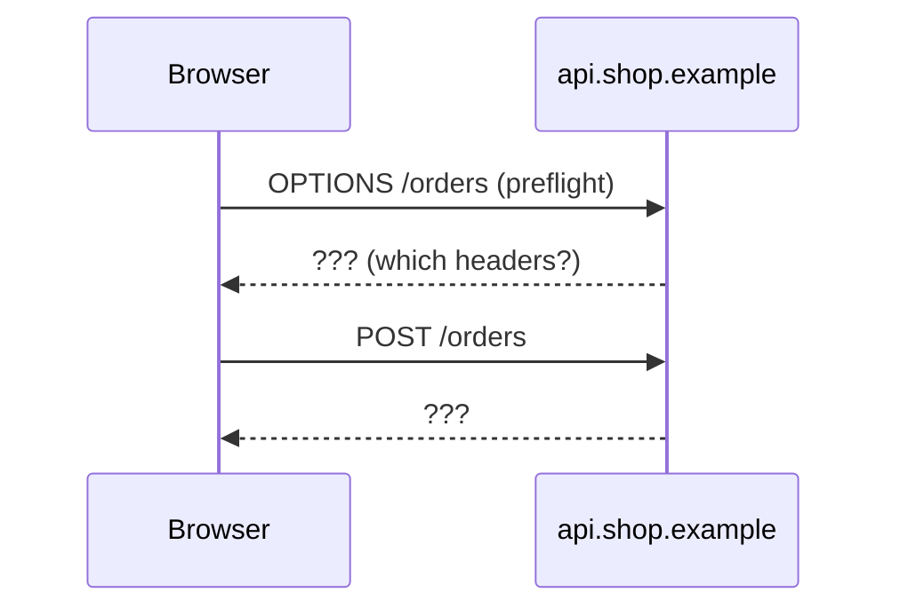

# Weekend 1 boss: the new checkout page

Time: 45 minutes. Do it on a computer.

> **Privacy first.** This task is made up, so it is safe to paste. If you add details from work, remove client names, code and internal numbers before you paste anything into Claude.

## The situation (example made up)

A shop moves its checkout page to a new address, `checkout.shop.example`.
The shop API stays at `api.shop.example`.
On the first test day, three things go wrong:

1. The browser blocks every call from the checkout page to the API.
2. The login cookie does not reach the API.
3. A slow phone network makes some customers tap "Pay" twice. Two orders are created.

You are the tech lead. Write a short design doc that fixes all three.
A design doc is a short plan you write before you code.
A Mermaid diagram is a drawing made from a few lines of text.

## Facts you may use

Each fact has its primary source. Read the new ones before the weekend, so the 45 minutes are for writing.

| Fact | Source |
|---|---|
| CORS (cross-origin resource sharing) lets a server share its responses with pages on other origins. The server must opt in with CORS headers. | [MDN: CORS](https://developer.mozilla.org/en-US/docs/Web/HTTP/Guides/CORS) |
| For some requests, the browser first sends an `OPTIONS` request. This is the preflight. | [MDN: CORS](https://developer.mozilla.org/en-US/docs/Web/HTTP/Guides/CORS) |
| HTTP is stateless. Cookies add state on top of it. | [MDN: Overview of HTTP](https://developer.mozilla.org/en-US/docs/Web/HTTP/Guides/Overview) |
| By default, a cross-origin `fetch()` sends no cookies. The page must set `credentials: "include"`. | [MDN: CORS, "Requests with credentials"](https://developer.mozilla.org/en-US/docs/Web/HTTP/Guides/CORS#requests_with_credentials) |
| With cookies, the server must answer `Access-Control-Allow-Credentials: true` and name one origin, never `*`. | [MDN: CORS, "Credentialed requests and wildcards"](https://developer.mozilla.org/en-US/docs/Web/HTTP/Guides/CORS#credentialed_requests_and_wildcards) |
| Idempotent means: sending the request twice has the same effect as once. Only `PUT`, `DELETE` and the safe methods, like `GET`, are idempotent. `POST` is not on that list. | [RFC 9110, section 9.2.2](https://www.rfc-editor.org/rfc/rfc9110.html#name-idempotent-methods) |
| An idempotency key is a unique key the client sends with a request, so a retry is safe. | [Stripe: Idempotent requests](https://docs.stripe.com/api/idempotent_requests) |
| A design doc shows the options you did not choose, and why. | [Design Docs at Google](https://www.industrialempathy.com/posts/design-docs-at-google/) |

## Steps

| Minutes | Step |
|---|---|
| 5 | Read the situation twice. Write down what you do not know yet. |
| 20 | Fill in the design doc below. Write 2 options for each problem, one line each. |
| 5 | Draw one Mermaid diagram of the request flow. A photo of a hand drawing is fine too. |
| 10 | Paste your doc into Claude with the coach prompt at the end. |
| 5 | Read the model answer. Then write 2 sentences from memory about what you learned. |

## Design doc template

```markdown
# Design doc: checkout on a new address

## Problem
<!-- What breaks, for whom, and how you will know it is fixed. 3 to 5 sentences. -->

## Options
<!-- For each of the 3 problems: at least 2 options. One line each. -->

## Decision
<!-- Which option for each problem, in one sentence each. -->

## Trade-offs
<!-- What each decision costs you. Example: more work, more risk, slower page. -->

## Risks
<!-- What can still go wrong, and how you will notice it. -->
```

## Mermaid diagram starter



Paste it into https://mermaid.live to see it. Change it until it shows your decision.

## Model answer

Read [week-1-boss-model-answer.md](week-1-boss-model-answer.md) only after the chat with the coach.

## Coach prompt

Paste this, then your design doc and your diagram, into a new chat at https://claude.ai/new.

```text
You are my tech lead coach.
Below is my design doc for a made-up checkout problem.
Do not give me a model answer yet.
Ask me ONE question at a time about my options and my decision.
Wait for my reply.
Give hints, not solutions.
After three rounds, tell me which trade-off I missed.
Then ask me to explain the trade-off again in my own words.
Show me two English mistakes and ask me to fix them.
```
